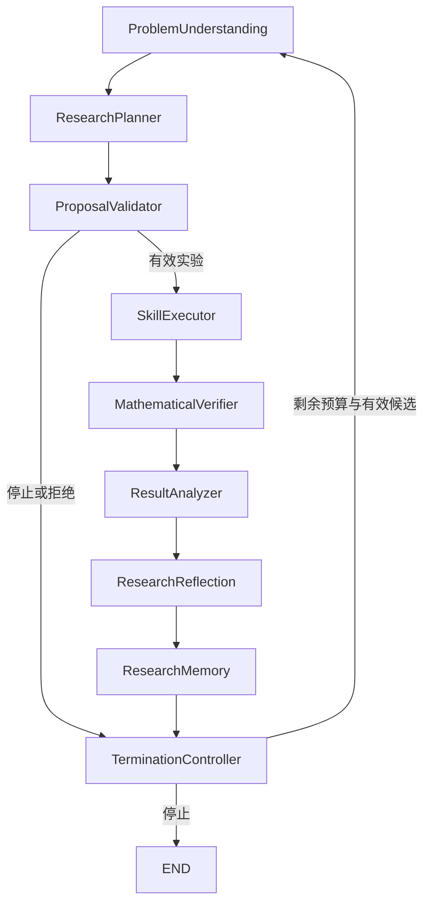

# LangGraph 自主数学研究智能体二次开发架构

本阶段在 WaferSched-Agent 独立仓库新增 `wafer_sched.langgraph_agent`。开源智能体编排主体是 LangGraph 1.2.15，数学求解仍由 v1.0.0 的 Simulator、规则、CP-SAT 和原 MaskablePPO 工具完成。Semantica 子集继续服务现有 ResearchMemory 的上下文与记忆索引，不作为本阶段的 Agent 主体。

截至 2026-10-14，DeepSeek 最小真实请求已返回 HTTP 200；正式 B 完成 12 轮真实规划、8 轮完整有效反思，12 个方案全部通过独立验证。A/C 各完成 16 轮。此前认证失败和提案回退轨迹保留，模拟单元测试不算研究成果。真实结果与预算限制见 `docs/wafer_sched_stage7.md`。

## 代码和依赖审计与最小方案

- 原仓库在 `main` 上工作区干净，HEAD 为 `9e96ff3c1de467eb49e56cb2f8d47ea09075d255`。`v1.0.0` 为已存在的注释标签，其标签对象为 `90f14ebcb57a6090f44e2d95e7edcad691e85f1a`。
- 在新增分支 `feature/langgraph-research-agent` 开发。未提交或推送，未移动 v1.0.0 或 main。
- 复用 `SkillRegistry`、`execute_experiment`、`VerificationSkill`、`replay_decisions`、`FeedbackEvaluator`、`DeterministicPlanner`、`FixedOrderPlanner` 和 `ResearchMemory`。
- 复用原模型 HTTP 接口的三个配置变量与 `validated_model_base_url`。原 transport 固定 5 秒子进程超时、4 秒 HTTP 超时、512 输出 Token；为真实研究提案新增同格式的有界 HTTP worker，配置更长的超时和输出上限，原 transport 不改动。
- 原数值依赖锁定文件和原虚拟环境不改动。新增可选 `langgraph` 安装项、独立虚拟环境、阶段七配置与依赖锁定记录。

## 九节点工作流

| 节点 | 实际职责 |
|---|---|
| ProblemUnderstanding | 读取允许的开发场景、静态负载、已验证历史、阻塞、利用率及原记忆检索结果 |
| ResearchPlanner | B 组向真实 LLM 请求结构化提案；A/C 使用原规划器。B 可选择下一开发场景、工具、CP 预算、原 PPO 模型或停止 |
| ProposalValidator | Pydantic 封闭 Schema 和原 ExperimentProposal 双层校验。服务器生成 ID、计算保守工具成本估计，拒绝越权参数、重复候选、虚构证据及超预算方案 |
| SkillExecutor | 经有类型的工具调用固定 Python worker，执行原规则、CP-SAT 或 PPO 推理。命令不来自 LLM |
| MathematicalVerifier | 原工具已独立验证，再经原 Simulator 重放保存的决策，核对完整性、状态、死锁和事件指标。UNKNOWN 不进入合法解档案 |
| ResultAnalyzer | 在同一实例内使用原字典序反馈判据，记录 Makespan 改进、成本、求解状态及拒绝原因 |
| ResearchReflection | 向 LLM 请求解释和下一可检验假设。反思只作研究文本；其合法性或最优性主张不覆盖验证结果 |
| ResearchMemory | 原 ResearchMemory 每场景独立保存；另保存全局逐轮记录。提交完成后形成实验边界检查点 |
| TerminationController | 检查轮数、活动墙钟预算、API 调用数、Token 与费用预算和提案停止决定，并决定是否循环 |

工具调用顺序由每轮有效提案决定；下一轮读取更新后的历史和反思，不是预先固定调用所有数学工具。

## 七个工具

工具均提供 Pydantic 输入 Schema，并注册为真实 `langchain_core.tools.StructuredTool`。统一输出为 `{ok, tool, output, wall_seconds}`，失败输出为 `{ok: false, tool, error_type, wall_seconds}`，避免错误原文夹带凭据或机器细节。

| 工具 | 输入要点 | 输出与原实现 |
|---|---|---|
| rule_scheduling | scenario_id、policy | 原 RuleSchedulingSkill 执行结果和事件指标 |
| cpsat_optimization | scenario_id、max_seconds | 原 CP-SAT 输出、证明状态、下界、回放结果及日志 |
| rl_policy_evaluation | scenario_id、model_id | 原已训练 PPO 推理、模型标识与哈希；不训练权重 |
| equipment_simulation | scenario_id、experiment_id | 原 Simulator 重放批准的保存决策；不接受任意路径 |
| constraint_verification | scenario_id、experiment_id | 容量、时序、完成、死锁、独立重放和指标一致性 |
| experiment_comparison | 场景、候选与 incumbent ID | 原 FeedbackEvaluator 和 ExperimentAnalysisSkill |
| research_history_query | 允许的 scenario_id | 原 ResearchMemory 检索证据及值拷贝历史 |

`OPTIMAL` 仅在求解模型声明范围内成立。`FEASIBLE` 不提供全局最优证明。`UNKNOWN` 不提供可回放候选。已验证但未改进的方案可以 `accepted=False`，并不等于约束非法。

## LLM 适配与凭据

- DeepSeek 采用 `POST https://api.deepseek.com/chat/completions`，模型名 `deepseek-flash`。请求使用 `response_format={"type":"json_object"}`、非流式输出、非思考模式及明确 JSON Schema 提示。
- 运行时只从被 Git 忽略的项目根目录 `.env` 显式读取 `ASSISTANT_LLM_BASE_URL`、`ASSISTANT_LLM_MODEL`、`ASSISTANT_LLM_API_KEY`，不隐式读取或回退到进程环境。缺失或空配置不允许 API 调用。`.env` 只解析三项 inert assignment，不执行替换或脚本。
- `.env.example` 无凭据，可作为公开模板。`.env`、`.env.*` 默认忽略，模板单独取消忽略。
- 密钥通过固定 HTTP worker 的 stdin 传入，不出现在命令行参数、研究状态、检查点或实验日志。响应和返回的 JSON 值在记录前脱敏。
- `llm_calls.jsonl` 保存模型、请求任务、响应、HTTP 状态、Token 用量、耗时及保守费用估计。不存在服务端用量时保留为空，不编造 Token 或账单。
- 原始 LLM 提案与实际执行提案分开保存；失败或不合法提案不会被回退提案覆盖。回退的 `actual_planner=DeterministicPlanner`，附 fallback 原因。

## 预算

默认每个 A/B/C 研究臂在 F/G 两开发场景间共享同一 600 秒活动墙钟预算，最多 16 次实验。单次数值 worker 最多 40 秒，CP 搜索分配累计最多 60 秒，每次 CP 预算来自 `[1,3,10,30]`。

B 组最多 36 次 LLM 调用、120,000 总 Token、0.20 美元估算费用，单响应最多 1,536 Token，单请求最多 45 秒。实验墙钟预算包含 LLM、工具、验证、研究记忆和图运行开销；暂停期间的停机时间不计入。导出图表的开销单列，不混称为求解时间。

调用前按输入 UTF-8 字节保守上界和最大输出预留 Token/费用，成功返回后按服务端用量结算。传输失败或用量未知时保留相应预留；401 等明确拒绝无成功用量记录。无自动重试，调用次数也受限。

费用采用 2026-10-14 核对的 DeepSeek Flash 高峰单价作为保守估计：输入缓存未命中 0.30 美元/百万 Token，缓存命中 0.006 美元/百万 Token，输出 1.20 美元/百万 Token。该字段是估计，不是服务商实际账单；价格变更时需更新配置。[官方模型与价格](https://api-docs.deepseek.com/quick_start/pricing/)

## 状态、检查点与恢复

Graph 状态包括全局轮次、每场景历史、原始/实际提案、实际规划器、调用元数据、待提交结果、反思、预算及终止理由。Python 对象、HTTP 凭据和数据库连接不放入状态。

LangGraph 使用真实 SqliteSaver。编译时 `interrupt_after=["ResearchMemory"]`：每次完整实验提交后持久暂停，下一次 `invoke(None)` 从 TerminationController 继续。CLI 可在指定实验边界退出，随后用 `--resume` 恢复。恢复要求场景、候选模型、配置和源代码身份一致，并核对检查点轮数与 ResearchMemory；未完成实验中间恢复不在本阶段支持范围内。

ResearchMemory 保留每场景独立记录，防止将 F/G 的不同 Makespan 直接比较；全局 `experiments.jsonl` 和 `decisions.csv` 保存跨场景顺序与下一轮提案。恢复不重新执行已经提交的工具。

## 三组实验与结果口径

A 使用原 DeterministicPlanner；C 使用原 FixedOrderPlanner，预先声明工具顺序。两组按场景交替分配实验机会。B 自主选择开发场景。三组共享场景、候选工具、随机种子和总预算上限。

对照分别报告每场景最终最好 Makespan、首次达到轮次、首次达到的本场景/全局累计工具时间、工具总时间、活动墙钟总时间、合法比例、重复比例及 LLM 额外时间、Token 和费用估计。未运行的 B 指标为空，图中没有假造 B 曲线。

`real_llm_acceptance_passed` 只有至少五轮真实 API 规划和真实反思、且数值验证通过时才可能为真。模型调用失败、固定流程和测试模拟响应都不计入真实 LLM 研究轮次。本次正式 B 通过该验收；一次反思截断、三次反思和最后规划被预算预留阻止，最终由确定性回退停止，均如实记录。

## 来源

- [LangGraph 上游仓库](https://github.com/langchain-ai/langgraph)，实际依赖版本 1.2.15。
- [LangGraph Graph API](https://docs.langchain.com/oss/python/langgraph/graph-api)与[持久化文档](https://docs.langchain.com/oss/python/langgraph/persistence)。
- [DeepSeek JSON 输出](https://api-docs.deepseek.com/guides/json_mode/)与[模式配置](https://api-docs.deepseek.com/guides/thinking_mode/)。
- 完整许可证及包版本证据见 `provenance/langgraph/LICENSE` 与 `provenance/langgraph_source.json`。未将未核实的上游 commit 写成已核实。
